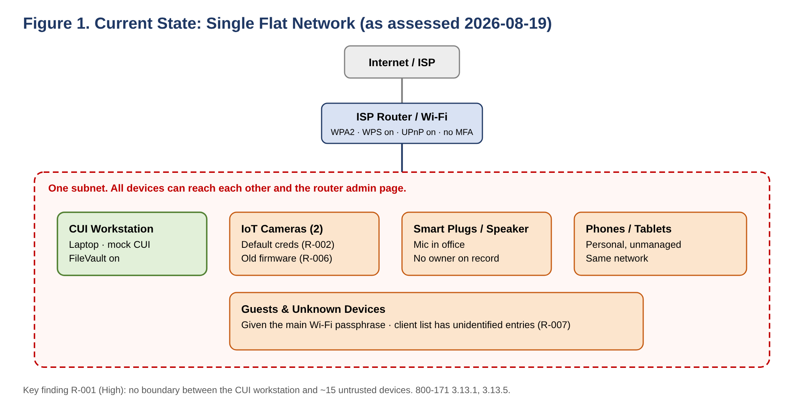
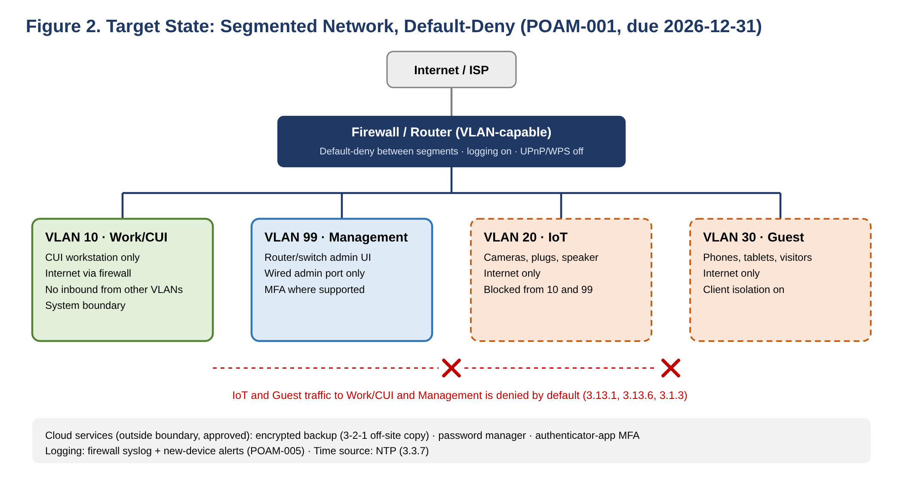
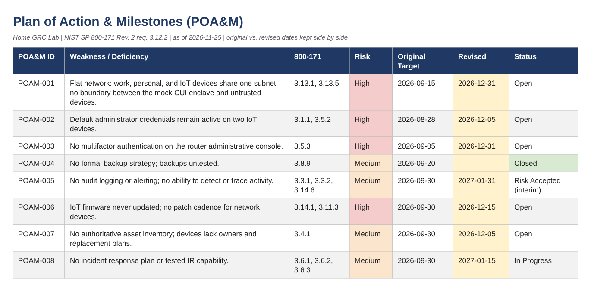

# Home GRC Lab: NIST SP 800-171 / CMMC Level 2 Readiness Package


A sanitized compliance package built against a home network scoped as a mock CUI environment. It's meant as a portfolio sample and as reusable templates for anyone building their own 800-171 or CMMC lab.

**Author:** Russell "Dusty" Broad, CISA, Security+ · [Medium](https://medium.com/@rbroad47)
**Framework:** NIST SP 800-171 Rev. 2 (110 requirements) · CMMC Level 2 · NIST CSF 2.0 for the governance approach

📝 **Write-up:** [CMMC Phase 2 Is Paused. I Finished My NIST 800-171 Home Lab Anyway.](https://medium.com/@rbroad47/cmmc-phase-2-is-paused-i-finished-my-nist-800-171-home-lab-anyway-a1f72cb4257b) · Earlier assessment: [Auditing My Home Network Against NIST CSF 2.0](https://medium.com/@rbroad47/auditing-my-home-network-against-nist-csf-2-0-a-hands-on-guide-to-practical-risk-management-ff0dcf6deb43)

## What's in the repo

| Artifact | 800-171 requirement | File |
|---|---|---|
| System Security Plan (v2.0) with current and target network diagrams | 3.12.4 | [`ssp/SSP_Home_GRC_Lab_Environment.docx`](ssp/SSP_Home_GRC_Lab_Environment.docx) |
| Control assessment (49 requirements) + risk register (v2.0) | 3.11.1, 3.12.1 | [`workbooks/Control_Assessment_and_Risk_Register.xlsx`](workbooks/Control_Assessment_and_Risk_Register.xlsx) |
| POA&M + 110-requirement control implementation matrix | 3.12.2 | [`workbooks/POAM_and_Control_Matrix_Home_GRC_Lab.xlsx`](workbooks/POAM_and_Control_Matrix_Home_GRC_Lab.xlsx) |
| Access Control Policy (POL-01) | 3.1, 3.5, 3.13.1/.3/.5/.6 | [`policies/POL-01_Access_Control_Policy.docx`](policies/POL-01_Access_Control_Policy.docx) |
| Incident Response Policy (POL-02) | 3.6, 3.3.1/.2/.7, 3.14.6/.7, 3.8.9 | [`policies/POL-02_Incident_Response_Policy.docx`](policies/POL-02_Incident_Response_Policy.docx) |
| Configuration Management Policy (POL-03) | 3.4, 3.11.2/.3, 3.14.1/.3 | [`policies/POL-03_Configuration_Management_Policy.docx`](policies/POL-03_Configuration_Management_Policy.docx) |
| Executive summary & gap analysis memo | — | [`reports/Executive_Summary_Gap_Analysis_Home_GRC_Lab.docx`](reports/Executive_Summary_Gap_Analysis_Home_GRC_Lab.docx) |

## Network architecture





## How the pieces connect

```
Risk Register (R-001..R-008)
      │  likelihood × impact → rating (formula)
      ▼
POA&M (POAM-001..008) ── milestones, original + revised dates, evidence of closure
      │
      ▼
Control Matrix (110 reqs) ── status · POA&M ref · governing policy section
      │
      ▼
Policies POL-01/02/03 ── each section cites its 800-171 requirement numbers
      │
      ▼
Executive Summary ── bottom line, posture, roadmap, decisions requested
```




## Current posture (as of 2026-11-25)

| Status | Requirements |
|---|---|
| Met | 32 |
| Partially Met | 14 |
| Not Met | 16 |
| Not Applicable | 2 |
| Not Assessed | 46 |

No SPRS-style score is reported yet. With 46 requirements unassessed, any score would overstate readiness.

## A note on version 2.0

The original Week 1 SSP and Week 2 assessment workbook were lost. Both were rebuilt as version 2.0 from the published risk register (R-001 to R-004) and the program documents. The per-control Week 2 results and risks R-005 to R-008 are an illustrative reconstruction consistent with those findings, and each file says so.

## Using these as templates

1. Replace the boundary description with your own environment.
2. Fill in the yellow input cells in the workbook (statuses, likelihood/impact, dates). The summary tab and ratings recalculate on their own.
3. Change policy parameters (lockout thresholds, patch timeframes, review cycles) to suit your risk tolerance.
4. Keep the traceability: every POA&M item points to a requirement and a policy section.

## Disclaimer

Mock environment for education and portfolio use. It contains no real CUI, IP addresses, serial numbers or credentials. It is not legal advice, and it isn't an official CMMC assessment.
